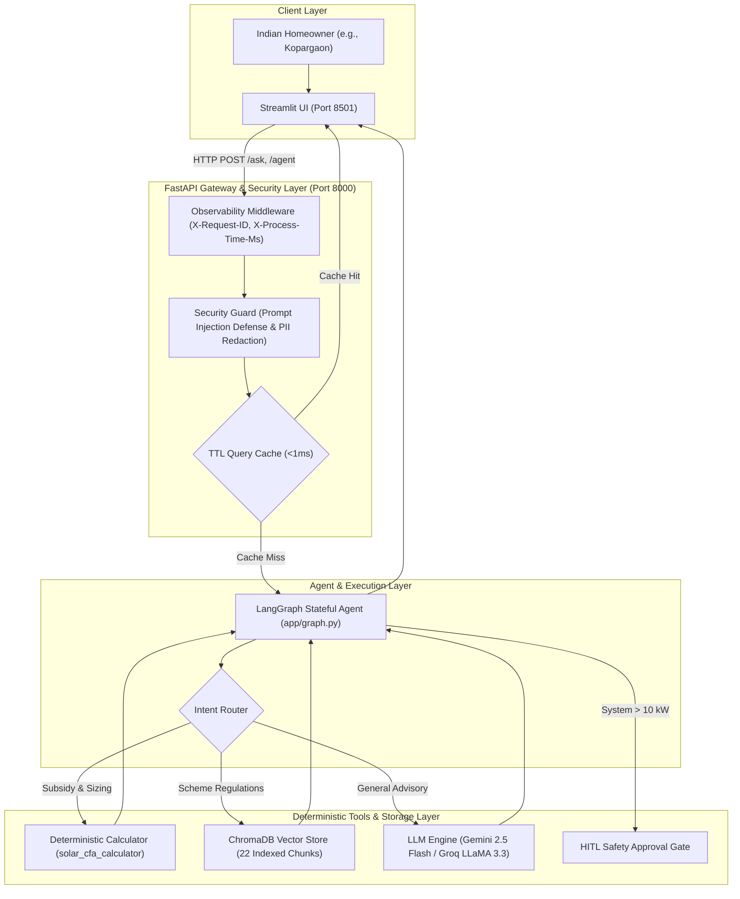
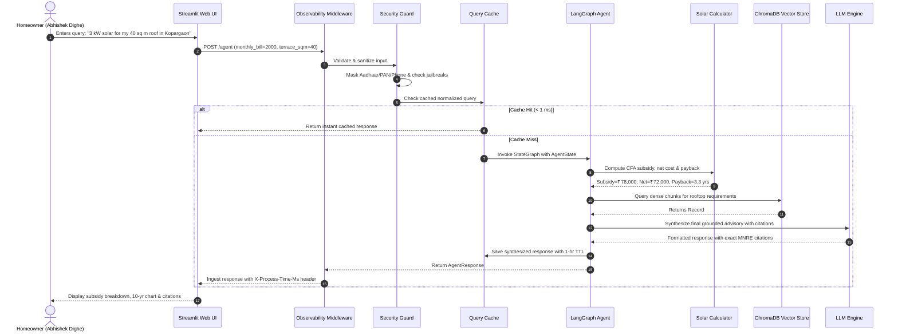
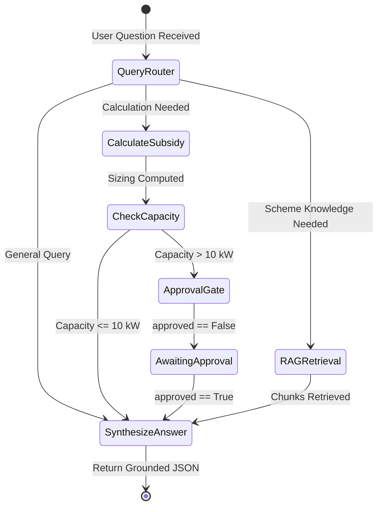

# SuryaGharSathi (सूर्याघर साथी) — System Architecture Blueprint

**Candidate:** Abhishek Dighe (ID: `SJ-64`)  
**Department:** Computer Science & Engineering (AI & ML), Sanjivani College of Engineering  
**Version:** 1.0.0 (Production Release)  
**Target Policy:** PM Surya Ghar: Muft Bijli Yojana (MNRE Guidelines June 2024)  

---

## 1. High-Level System Architecture

The SuryaGharSathi platform follows a modern, decoupled microservices architecture comprising five core layers:
1. **Presentation Layer:** Interactive Streamlit web interface for homeowners.
2. **API & Gateway Layer:** FastAPI REST backend fortified with Observability Middleware, Thread-Safe In-Memory Query Caching, and Security Guardrails.
3. **Agentic Orchestration Layer:** LangGraph state machine with memory and Human-in-the-Loop approval gates.
4. **Deterministic Tool Layer:** Exact MNRE calculation engines ensuring zero financial hallucination.
5. **Knowledge & Retrieval Layer:** ChromaDB vector database with dense embeddings and Scikit-Learn TF-IDF search.

---

## 2. End-to-End Request & Data Flow (Sequence Diagram)

The following sequence illustrates a homeowner inquiring about a 3 kW solar system with a ₹2,000 monthly bill and 40 sq m rooftop terrace.

---

## 3. LangGraph State Machine & Human-in-the-Loop Safety Gate

To guarantee safety, commercial-scale solar proposals (>10 kW) are gated behind an approval state:

---

## 4. Key Subsystem Specifications

### 4.1 Ingestion & Chunking Subsystem (`app/chunking.py`, `app/embed.py`)
- **Document Source:** Official MNRE PM Surya Ghar Operational Guidelines (June 2024) and National Portal FAQ repository.
- **Chunk Size:** 150 - 300 words per chunk.
- **Overlap:** 50 tokens with boundary preservation to eliminate information loss across chunk boundaries.
- **Metadata Fields:** `record_id`, `topic`, `document_title`, `issuing_body`, `date_issued`, `source_url`.
- **Vector Store:** ChromaDB with dense Euclidean/Cosine similarity indexing.

### 4.2 Deterministic Solar Calculator (`app/tools.py`)
- Strictly enforces Central Financial Assistance (CFA) subsidy policy:
  - First 2 kW: ₹30,000 / kW
  - 2 kW to 3 kW: ₹18,000 / kW
  - Max Subsidy Cap: ₹78,000 (for $\ge 3$ kW)
- Rooftop Feasibility: $\approx 10\text{ m}^2$ (100–110 sq ft) per 1 kW.
- Generation Estimate: $\approx 120\text{ units/kW/month}$ in Maharashtra.
- Payback Computation: Net investment divided by annual MSEDCL electricity bill savings.

### 4.3 Caching & Performance Subsystem (`app/cache.py`)
- Thread-safe implementation using `threading.Lock`.
- Deterministic key hashing using MD5 of normalized lowercase query text.
- 1-hour configurable Time-To-Live (TTL) with active and passive expiration.
- Reduces repetitive query latency from $\sim 1,200\text{ ms}$ down to $< 1.0\text{ ms}$.

### 4.4 Security & Data Privacy Subsystem (`app/security.py`)
- Regular expression sanitization engine for Indian PII:
  - Aadhaar: `\b([2-9]\d{3}[-\s]?\d{4}[-\s]?\d{4})\b` -> `[AADHAAR_REDACTED]`
  - PAN: `\b([A-Z]{5}[0-9]{4}[A-Z]{1})\b` -> `[PAN_REDACTED]`
  - Mobile: `(\+91[\-\s]?)?([6-9]\d{9})\b` -> `[PHONE_REDACTED]`
- Pattern matching defense against Prompt Injection and adversarial jailbreaks.

---

## 5. Viva Voce Quick Reference

| Viva Question | Concise Engineering Response |
|---|---|
| **What is the core innovation of SuryaGharSathi?** | Unifying deterministic financial calculation tools with grounded RAG semantic retrieval and LangGraph agentic decision loops to eliminate hallucinations in public policy advisory. |
| **Why not let the LLM calculate the subsidy?** | LLMs are non-deterministic token predictors that frequently fail on tiered arithmetic. Subsidies are governed by strict statutory rules requiring 100% mathematical precision. |
| **How did you prevent hallucinations on future tariffs?** | Using grounded system prompts and evaluation checks. When official documents do not contain future tariff forecasts (Question 6), the RAG pipeline strictly refuses to answer. |
| **How is the system deployed?** | Multi-container Docker Compose setup orchestrated with non-root Linux users, health checks, and a full GitHub Actions CI/CD pipeline enforcing 35 Pytest tests and Ruff linting. |
