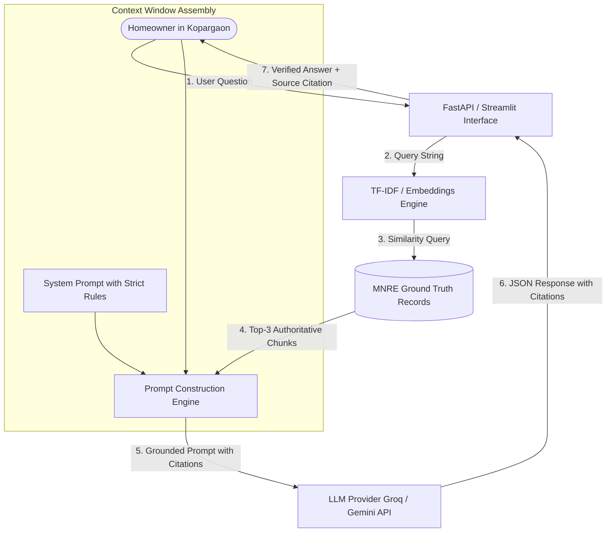

# How LLMs Work: Core Concepts & SuryaGharSathi AI Architecture

Author: Abhishek Dighe (SJ-64)  
Project: SuryaGharSathi (सूर्याघर साथी)  
Focus: PM Surya Ghar Muft Bijli Yojana Advisory Assistant  

---

## 1. What is an LLM (Large Language Model)?

A **Large Language Model (LLM)** is a deep neural network with billions of parameters (weights) trained on vast corpuses of text to understand, summarize, generate, and reason over natural human language.

In the context of **SuryaGharSathi**, an LLM acts as the **reasoning and communication engine**. Rather than forcing a homeowner in Kopargaon to read a 40-page government gazette, the LLM translates complex bureaucratic policy rules into clear, empathetic, and easily understandable guidance in plain language.

---

## 2. How Does an LLM Actually Work?

At its core, an LLM is a **statistical next-token prediction engine**.
1. **Neural Network Layers:** Composed of stacked Transformer layers (typically 32 to 128 layers).
2. **Self-Attention Mechanism:** Allows the model to weigh the importance of different words in a sentence relative to one another, regardless of their distance (e.g., connecting *"subsidy"* with *"₹78,000"* and *"3 kW"* across multiple paragraphs).
3. **Training Process:**
   - **Pre-training:** Learns grammar, facts, and reasoning patterns by predicting masked or next tokens across trillions of text tokens.
   - **Instruction Tuning (SFT):** Fine-tuned on paired prompts and ideal assistant answers to follow directions.
   - **RLHF / DPO:** Aligned with human preferences for helpfulness, harmlessness, and honesty.

> **Crucial Insight:** An LLM does not "think" or look up a database when speaking on its own—it samples words based on learned probability distributions. This is why raw LLMs cannot be trusted with exact subsidy math or changing government dates without RAG.

---

## 3. What are Tokens?

Computers cannot process letters or words directly. Text is broken down into numerical chunks called **tokens**.
* A token is roughly **3/4 of an English word** (or ~4 characters).
* Common words like `"solar"` or `"power"` are single tokens.
* Numerical amounts, Marathi names, or acronyms like `"MSEDCL"`, `"₹78,000"`, or `"Kopargaon"` may be split into 2 to 4 tokens (e.g., `["Kop", "ar", "gaon"]`).

### Why Tokens Matter in SuryaGharSathi:
1. **Cost & Latency:** LLM API providers (Groq, Gemini, OpenAI) charge per 1,000 or 1,000,000 input and output tokens. Longer prompts cost more and increase latency.
2. **Context Budgets:** Every document chunk we pass to the LLM consumes token space.

---

## 4. What is a Context Window?

The **Context Window** is the maximum number of tokens an LLM can "see" and process in a single conversation turn (input prompt + conversation history + output generation).
* Modern LLMs feature context windows ranging from **8,192 tokens** (e.g., Llama-3-8B) to **1,000,000+ tokens** (e.g., Gemini 1.5 Pro).
* In SuryaGharSathi, our context window holds:
  1. System Prompt (Safety guidelines & role).
  2. Retrieved Document Chunks (Top 3 relevant scheme rules from MNRE guidelines).
  3. Conversation History (User's prior messages).
  4. User's Current Question.

---

## 5. What is a System Prompt?

A **System Prompt** is a persistent, top-level meta-instruction that sets the model's persona, operational boundaries, tool access rules, and behavioral constraints before user interaction begins.

### SuryaGharSathi's Golden System Prompt Rule:
> *"You are SuryaGharSathi, an official solar advisory assistant. Answer solely using the provided retrieved context. If the retrieved context does not contain enough verified information to answer the question, you MUST say: 'I cannot confirm this from the available official documents.' You must NEVER invent subsidy values or future tariffs."*

---

## 6. What is Prompt Engineering?

**Prompt Engineering** is the discipline of structuring, phrasing, and constraining inputs to an LLM to reliably elicit accurate, safe, and formatted outputs.
* **Zero-Shot:** Asking the model directly without examples.
* **Few-Shot:** Providing 2–3 input/output examples inside the prompt to establish tone and format.
* **Chain-of-Thought (CoT):** Asking the model to "think step by step" before stating a final conclusion.
* **Structured Output (JSON Mode):** Constraining the LLM to reply strictly in valid JSON matching a Pydantic schema (`{"answer": "...", "confidence": "high", "citations": [...]}`).

---

## 7. What are Hallucinations?

A **hallucination** occurs when an LLM generates plausible-sounding but factually false, unverified, or fabricated information.

### Why Hallucinations are Dangerous in Solar Advisory:
* If a homeowner asks: *"What is the subsidy for a 5 kW system?"*
* A raw LLM might hallucinate: *"You will get ₹30,000 per kW, so ₹1,50,000."*
* **The Reality:** The scheme strictly caps the general residential subsidy at **₹78,000** (achieved at 3 kW). Beyond 3 kW, subsidy is zero. A hallucination could cost a consumer ₹72,000!
* **How We Prevent Hallucinations:**
  1. Using **RAG** (Retrieval-Augmented Generation) to supply factual context.
  2. Routing numerical calculations to our deterministic Python tool `solar_cfa_calculator`.

---

## 8. What is Temperature?

**Temperature** is a hyperparameter (between `0.0` and `2.0`) that controls the randomness of token selection during generation:
* **Low Temperature (`0.0` to `0.2`):** Highly deterministic, conservative, and focused. The model always selects the highest-probability token. Ideal for legal, financial, and regulatory Q&A like SuryaGharSathi.
* **High Temperature (`0.7` to `1.0+`):** Creative, varied, and unpredictable. Ideal for brainstorming or creative writing.
* **Our Project Choice:** `temperature = 0.1` for maximum adherence to official MNRE guidelines.

---

## 9. RAG vs Fine-Tuning: Key Differences

| Dimension | Retrieval-Augmented Generation (RAG) | Fine-Tuning |
|:---|:---|:---|
| **What it does** | Retrieves external verified documents and passes them as prompt context. | Adjusts the actual internal weights ($\theta$) of the neural network. |
| **Data Freshness** | **Instantaneous:** Update `records.json` and the model cites the new rule immediately. | **Slow & Expensive:** Requires retraining weights when policies change. |
| **Hallucination Control** | **Very High:** Responses cite specific document titles, dates, and URLs. | **Moderate/Low:** The model can still hallucinate outdated dates. |
| **Auditability & Citations** | **Yes:** Direct source citations attached to every claim. | **No:** Internal weights cannot output verifiable source links. |
| **Cost & Compute** | Runs cheaply on commodity servers and free vector DBs. | Requires expensive GPU clusters (A100/H100) and ML training pipelines. |
| **Best Used For** | **Regulatory policies, changing schemes, and accurate Q&A.** | Teaching specific tone, dialect, or niche syntax. |

**Verdict for SuryaGharSathi:** RAG is the unequivocally superior engineering choice because government subsidy rules and DISCOM circulars change regularly.

---

## 10. SuryaGharSathi System Architecture Diagram

---

## 11. 10 Real SuryaGharSathi User Questions

These 10 benchmark questions represent authentic inquiries from our target user persona (a homeowner in Kopargaon with a ₹2,000 monthly bill and 40 sq m terrace):

1. **Q1:** *How much central subsidy will I get for a 3 kW rooftop solar system?*  
   *(Expected: ₹78,000 calculated via ₹30,000/kW for first 2 kW + ₹18,000 for 3rd kW).*
2. **Q2:** *How much shadow-free terrace area do I need for a 1 kW or 3 kW setup?*  
   *(Expected: ~10 sq m per kW, so ~30 sq m for a 3 kW system).*
3. **Q3:** *What is the minimum warranty on solar panels and inverters under PM Surya Ghar?*  
   *(Expected: 10-year product warranty & 25-year performance warranty on modules; 5-year warranty on inverters).*
4. **Q4:** *I want 4 kW on my house in Kopargaon. How much subsidy do I get, and do I still need net metering from MSEDCL?*  
   *(Expected: Maximum ₹78,000 cap; net metering from MSEDCL remains mandatory).*
5. **Q5:** *My vendor says I must pay full cost first and subsidy comes later. Is that right, and in how many days is the subsidy released?*  
   *(Expected: Yes, consumer pays vendor, and DBT subsidy is credited within 30 days of commissioning).*
6. **Q6 (CRITICAL UNANSWERABLE QUESTION):**  
   ***What will MSEDCL's electricity tariff per unit be next year?***  
   *(Expected Behavior: The system MUST state: "I cannot confirm this from the available official documents. MSEDCL tariffs are determined by MERC and are not covered in PM Surya Ghar scheme guidelines." Model must NEVER guess future rates).*
7. **Q7:** *Are imported Chinese solar panels eligible for central financial assistance under the scheme?*  
   *(Expected: No. Only DCR-compliant modules using domestically manufactured cells/modules from the ALMM list are eligible).*
8. **Q8:** *Who is responsible for system maintenance after installation and for how long?*  
   *(Expected: The registered empanelled vendor must provide 5 years of free comprehensive O&M).*
9. **Q9:** *How does net metering adjust surplus solar units on my monthly electricity bill?*  
   *(Expected: Bi-directional meter records import and export; surplus units are banked and credited against future billing cycles).*
10. **Q10:** *How long does MSEDCL take to grant technical feasibility approval after I apply on the National Portal?*  
    *(Expected: DISCOM must issue feasibility approval within 15 days, failing which deemed approval is granted).*
